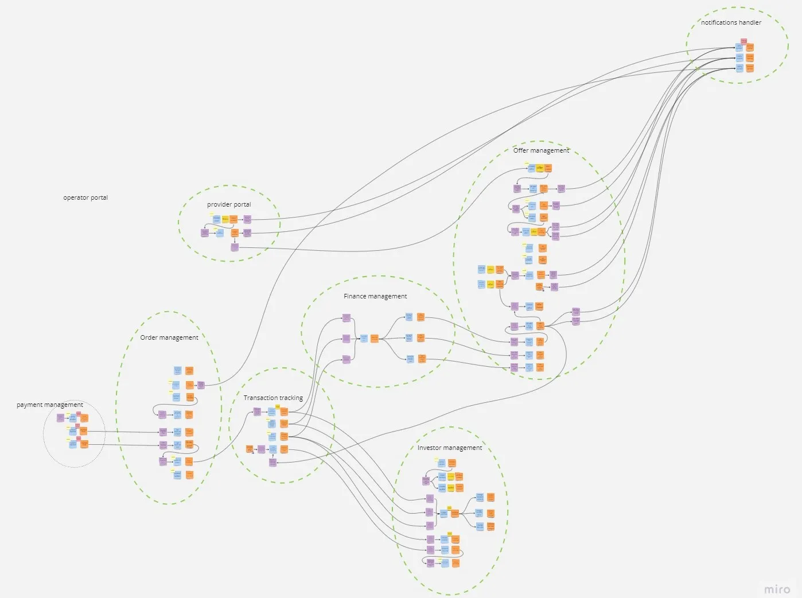
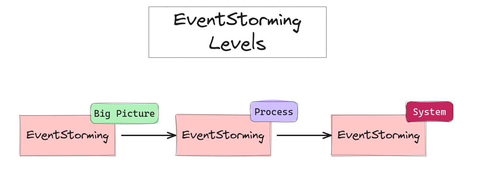
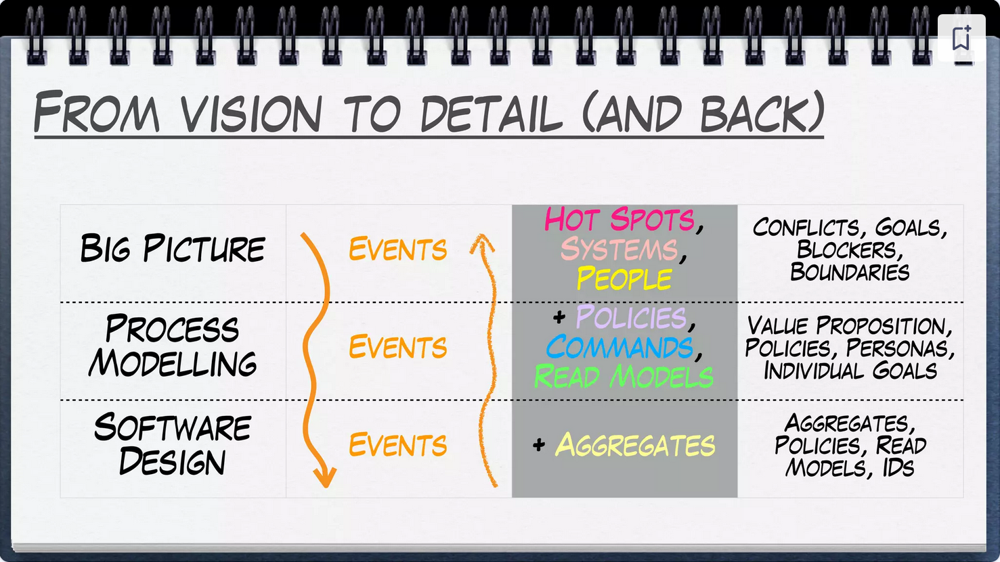
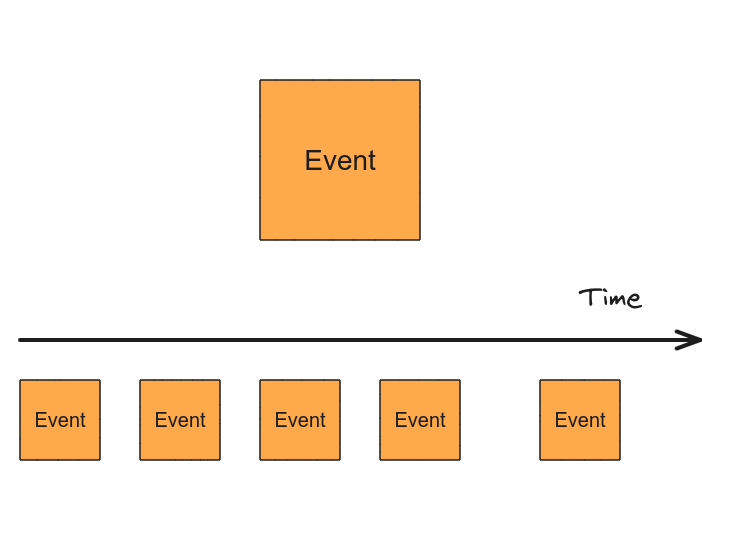
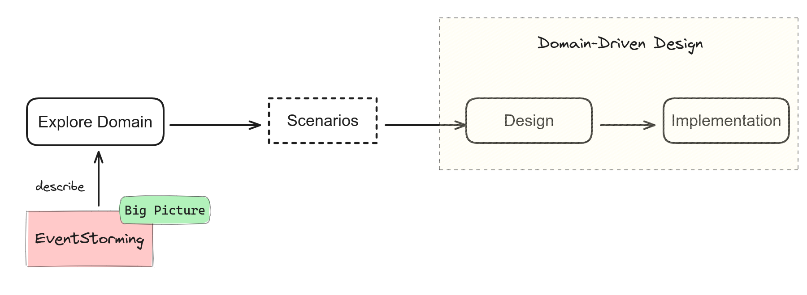
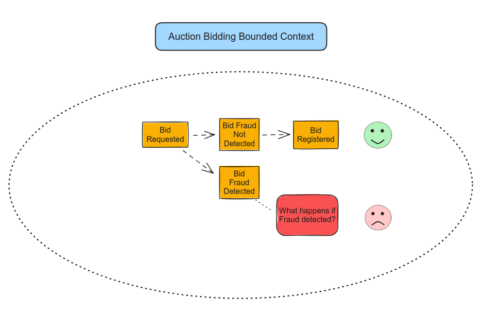
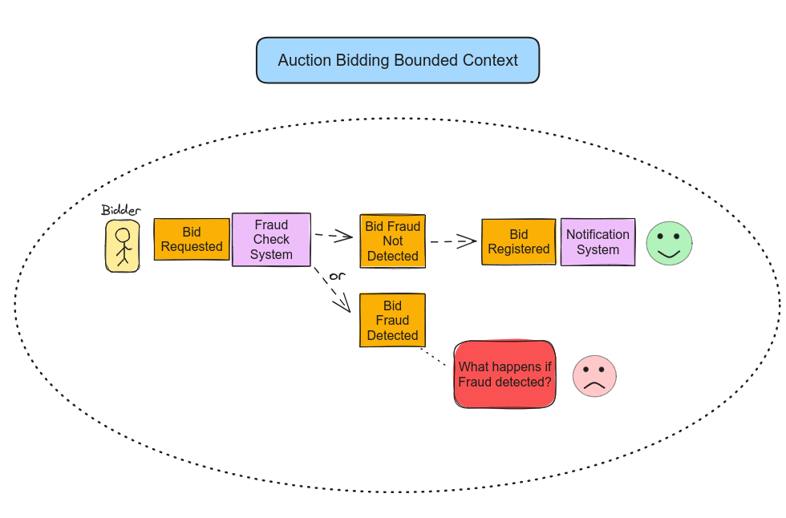
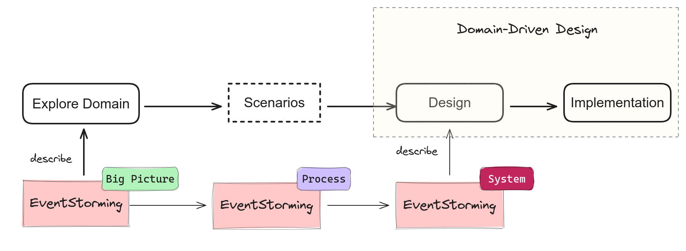
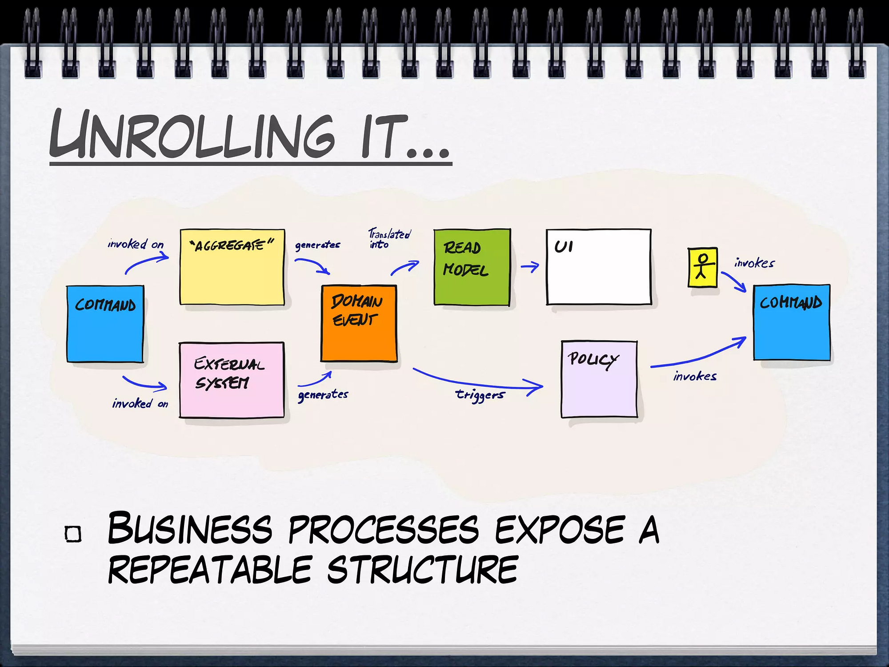

EventStorming, developed by Alberto Brandolini, is an ideation technique that supports the process-oriented approach. It introduces new modeling primitives and outlines methods for conducting engaging workshops with diverse stakeholders.

> EventStorming aims to address both aspects: the ‘what’ (scenarios, model) and the ‘how’ (engaging people in the modeling process).

Domain-Driven Design (DDD) has long been a powerful approach for tackling complex software projects, but the journey from domain understanding to effective design can be challenging. Traditionally, DDD practitioners have often started by identifying domain objects, focusing primarily on nouns and structures. However, this approach can sometimes lead to premature structural decisions, potentially overlooking crucial domain processes.

This article explores the synergy between EventStorming and Domain-Driven Design. We’ll examine how EventStorming can enhance domain exploration, facilitate shared understanding among stakeholders, and potentially bridge the gap between analysis and design in DDD projects.

## What is EventStorming?

EventStorming is a dynamic, collaborative modeling technique designed to unravel the complexities of business domains. At its core, it’s about fostering an environment where teams can freely explore and map out their domain knowledge. This approach recognizes that the often-overlooked aspects of human interaction and collaborative spaces are crucial in laying a solid foundation for subsequent design processes.

Pioneered by Alberto Brandolini, EventStorming brings together a diverse group of participants — from domain experts to development team members — to create a visual narrative of a system’s behavior. The primary tool? **Sticky notes on a large surface**. This seemingly simple setup becomes a powerful medium for mapping out domain events and other key elements of the system.

_Example of the canvas with sticky notes — outcome of the EventStorming session. Source: Event Storming — The Storm That Cleans Up The Mess! by Samar Benamar_

The workshop-style format of EventStorming serves multiple purposes:

1.  It rapidly builds a shared understanding of business processes.
2.  It uncovers hidden complexities that might be missed in traditional modeling approaches.
3.  It aligns the mental models of all participants, bridging the gap between technical and non-technical stakeholders.

EventStorming shines particularly bright in several areas:

- Identifying bounded contexts within a complex domain
- Discovering aggregates that form the building blocks of the system
- Laying the groundwork for an event-driven architecture

The visual and interactive nature of EventStorming makes it uniquely accessible. It breaks down barriers between different roles and expertise levels, fostering better communication and often revealing insights that might remain hidden in more traditional, formal modeling approaches.

## From Big Picture to Detailed Design

EventStorming is an iterative process that typically unfolds across several levels, each building upon the previous one with increasing detail and complexity. These levels can be viewed as a progressive design journey, where each step adds layers of insight and refinement to the model. As teams advance through these levels, they gain a deeper, more nuanced understanding of the domain, uncovering hidden complexities and relationships that might not be apparent at first glance.

_EventStorming Iterative Process_

The iterative nature of EventStorming allows teams to revisit and refine their models, ensuring that each level of detail is grounded in a solid understanding of the broader context. This approach enables participants to gradually transition from a high-level, big-picture view of the domain to a more granular, implementation-ready model, all while maintaining alignment with the core business processes and goals.

The original EventStorming technique distinguishes three primary levels:

1.  **Big Picture Level**  
    _Goal_: Understand the big picture of the business domains  
    _Toolbox_: Event, System, People, Hotspot
2.  **Process Level**  
    _Goal_: Dive deeper into how processes work  
    _Toolbox_: Event, Policy, Command, Read Model
3.  **Design Level (System, Software)**  
    _Goal_: Bridge the gap between business processes and software design  
    _Toolbox_: Aggregate

As teams progress through these levels, the modeling language evolves, incorporating new concepts that build upon the foundation laid in previous stages:

_Source: Software design as a cooperative game with EventStorming by Alberto Brandolini_

The final level, Software Design, suggests its potential application in the design phase. We'll explore the implications of this in the context of Domain-Driven Design Tactical Patterns later in this article.

## Core Concept: Domain Event

At the heart of EventStorming lies the concept of a Domain Event - a significant occurrence or state change within the business domain. By visually representing these events in chronological order, EventStorming creates a compelling narrative of business processes.

_BigPicture EventStorming — Domain Event Timeline_

This approach taps into the power of storytelling, a deeply ingrained human cognitive tool. By framing the analysis as a sequence of events — a story of the domain — EventStorming makes complex business processes more intuitive and accessible to all participants, regardless of their technical background.

## Big Picture: Mapping the Domain Landscape

The Big Picture EventStorming level serves as the entry point for domain exploration. It maintains a laser focus on domain events, deliberately setting aside less crucial details. This approach is crucial because domain analysis often risks diving too deep into topics that, while interesting, may not be central to the core domain.

By keeping the focus narrow, Big Picture EventStorming helps teams avoid creating overly complex models that fail to effectively communicate the most relevant aspects of the domain. Instead, it allows teams to quickly identify and prioritize key scenarios, providing vital input for the subsequent design process.

_Big Picture EventStorming place in the Domain-Driven Design Workflow_

n Big Picture EventStorming, teams use a specific set of modeling elements, each represented by different colored sticky notes:

**Domain Events (Orange sticky notes)**

- These represent significant occurrences or state changes in the business domain
- They’re written in past tense (e.g., “Order Placed”, “Payment Received”) to emphasize their nature as completed actions
- Placed on a timeline from left to right, they help identify the core business processes and workflow

**Hotspots (Pink sticky notes)**

- These highlight areas of conflict, uncertainty, or risk in the process
- They can represent technical challenges, business rule conflicts, or areas needing further clarification
- Often placed near related domain events or between conflicting elements, they serve as flags for future discussion or investigation

**Systems (Green sticky notes)**

- These represent external systems or services that interact with the main process
- They can include third-party APIs, legacy systems, databases, or other microservices
- Placed near the domain events or commands they’re associated with, they help map out system interactions

**People (Often represented by stick figures)**

- These represent different roles or actors in the process
- They can include customers, employees, system administrators, or external stakeholders
- They help identify who is involved at each stage of the process

Once the team has developed a comprehensive understanding of the overall scenario, they can progress to the next stages of the design workflow. It’s important to note that this doesn’t necessarily mean continuing with EventStorming exclusively. The choice of further modeling techniques depends on various factors, especially when aligning with a Domain-Driven Design (DDD) approach.

In DDD, the design process is guided by the Model-Driven Design principle. This requires the modeling language to closely reflect concepts from the software tools selected for system implementation. Additionally, the modeling language needs to be DDD-compatible, capable of expressing core DDD building blocks such as aggregates and entities. I cover these aspects in more detail in my other articles.

Let’s explore how this concept translates into practice.

## EventStorming in Action: A Bidding System Case Study

To illustrate these concepts, let’s consider a use scenario for a bidding process in an Auction System:

> Auction Bidding Scenario

> When a Bidder wants to add a bid for an auction, the system must verify whether the bid shows signs of fraud. This verification is handled by a specialized external system capable of detecting suspicious bidding patterns and bidders. The system must reject any bids that raise a red flag. If the bid passes this check, it’s registered in the auction, and the bidder is officially in the game. Following a successful bid, all bidders are notified about the new bid via email.

### Iteration 1: Domain Events Only + HotSpot Identification

_Iteration 1: Big Picture EventStorming for an Auction Bidding Bounded_

In this initial iteration, we see the core domain events laid out chronologically. The hotspot (red sticker) identifies a potential issue or area of uncertainty in the process. At this stage, Big Picture EventStorming is purely analytical, helping the team conceptualize the business process and identify potential challenges.

### Iteration 2: Adding Actors and Systems

_Iteration 2: Big Picture EventStorming for an Auction Bidding Bounded Context_

In the second iteration, the team enriches the model by adding key actors and systems:

1.  The Bidder: The primary actor who initiates the entire business process.
2.  Fraud Check System: An external system that analyzes bid requests for signs of fraud, generating a single event as a result.
3.  Notification System: Responsible for sending messages to all bidders participating in the auction.

This iteration provides a more complete picture of the process, showing not just what happens, but who or what is involved at each step.

## Bridging Domains and Design: EventStorming in Software Design

While EventStorming excels at domain exploration, its potential extends into the realm of system design. This application involves a progression through the EventStorming levels, from Big Picture to Process Level, and finally to System Design Level. This sequential application within the context of Domain-Driven Design can be visualized as follows:

_Design process overview — EventStorming for System Design_

The EventStorming System Design toolbox expands to include additional elements:

_Transactions redefined by Alberto Brandolini_

In the Process and System Design Levels of EventStorming, teams introduce new modeling elements:

- **Bidding Anti-fraud Policy (Policy)** — Initiates checks to determine if a bid shows signs of fraud
- **Bid Registration Policy (Policy)** — Triggers the official registration of a bid if it passes the fraud check
- **Auction (Aggregate)** — Controls domain invariants related to bid registration in the auction
- **Fraudulent Bid Policy (Policy)** — Handles further actions if a registered bid is flagged as fraudulent
- **Auction Data (Read Model)** — Presents data about the current state of the auction
- **Notification System (System)** — Responsible for sending out custom messages
- **Analyze Highest Bidder Policy (Policy)**
- Calculates the current leading bidder in the auction
- Initiates the process to notify all bidders about the auction’s current status
- Retrieves auction information (bids and bidders) from the Read Model

In this example, Policies are triggered by events. However, it’s worth noting that Policies can also be triggered by Actors. For instance, the Fraudulent Bid Policy could potentially involve a manual process requiring an Auction employee to provide input and make final decisions on how to handle suspicious bids.

When identifying Aggregates, Commands serve as a natural starting point. Commands can be viewed as methods that are executed on Aggregates. It’s common for the same Aggregate to appear multiple times in a diagram, as we see with the Auction aggregate being invoked for Bid Request, Bid Registration, and Bid Cancellation.

This detailed model provides a comprehensive view of the bidding process, mapping out not just the sequence of events, but also the decision points, data flows, and system interactions involved. It serves as a powerful tool for understanding the system’s behavior and can guide further design and implementation efforts.

## Summary

Key takeaways from our exploration of EventStorming include:

1.  **Levels of Detail**: EventStorming progresses through three main levels — Big Picture, Process Level, and Design Level — each adding more granularity and moving closer to software design.
2.  **Core Concepts**: The technique revolves around domain events, using them to create a narrative flow of business processes. This storytelling approach makes complex domains more accessible to all stakeholders (technical and non-technical).
3.  **Versatility**: From initial domain exploration to detailed system design, EventStorming proves adaptable to various stages of the software development lifecycle.
4.  **DDD Alignment**: EventStorming naturally aligns with many DDD concepts, particularly in identifying bounded contexts, aggregates, and domain events. However, a deeper understanding of EventStorming mapping to DDD is needed to uncover whether DDD is suitable for Deep Domain modelling (I will dedicate a seperate article to this topic).
5.  **Collaborative Nature**: By bringing together diverse stakeholders, EventStorming fosters a shared understanding of the domain, potentially reducing misunderstandings and improving system design.
6.  **Iterative Process**: The technique encourages iterative refinement, allowing teams to progressively add detail and uncover insights.
