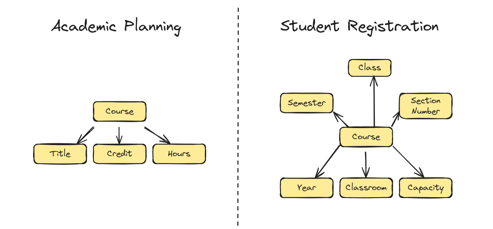
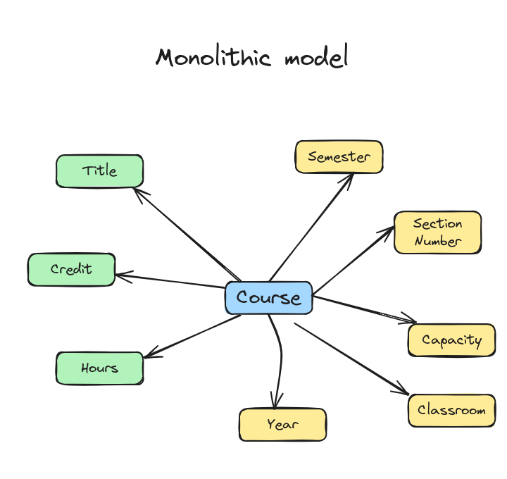
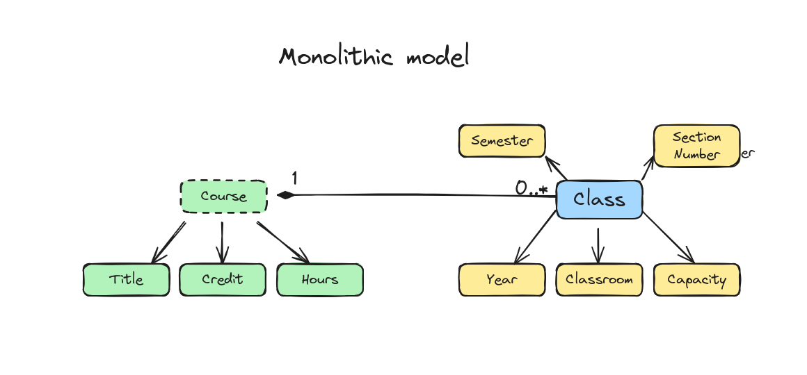
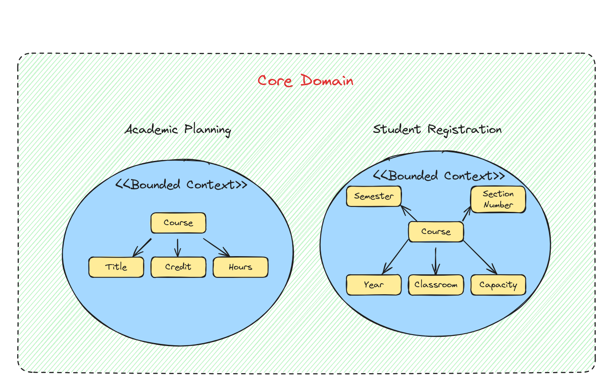
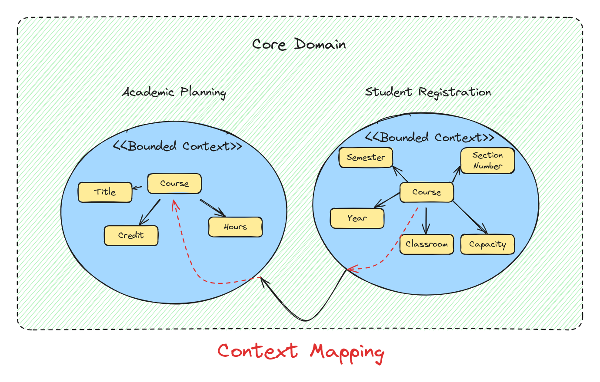

“Divide et impera,” or “Divide and conquer,” was not only a renowned Roman military strategy for global dominance but also a pacifistic insight that inspired some of the brightest minds to tackle algorithmic complexity. A prime example is the Quicksort sorting algorithm. It breaks down a large problem into random, smaller pieces until division is no longer feasible. Subsequently, a final solution materializes through a bottom-up approach that consolidates the intermediate outcomes.

I wish more aspects of life operated on this seamless and graceful principle. Can it work also for Domain modelling though?

## Table of contents

## Embracing the Chaos

The design process can be daunting, cumbersome, and full of surprises. A “standard approach” — that I was still taught at the university — was prescribing a consistent, monolithic domain model as a key to every success and prosperity. I remember huge canvases hanging on the walls with printed out UML class diagrams with dozens of associations shooting in all the directions. I am still in owe for those who were creating and hanging them. At that time, the art of business analysis and design laid in discovering homonyms and synonyms in the domain.

- **Same term different meaning**  
  Aha! A Class and a Section Number are indeed the same concept but with different names.  
  Or
- **Same concept, different use**  
  Aha! Course in Student Registration and a Course in Academic Planning - are not the same concepts! Different teams just used the same name to denote something different. We spotted it!

The success of a business analyst lies in their miraculous skills and the ability to identify pitfalls that remain unseen by others, even by those with years of experience in the business. Certainly, humans are not blind. Indeed, we are quite inventive in creating solutions to manage inconsistencies. We develop these workarounds and eventually become accustomed to their presence, no longer noticing them. This is a form of cognitive economy. The goal of the design team in this paradigm is to render the abstract world of concepts logically connected, succinct, complete, and ultimately consistent — not just eventually consistent. This process has a touch of the divine, fulfilling a metaphysical desire to connect with the Absolute.

This is how I at least pictured it when I was younger and when I was in a promising position to enter the world of business analysis. Aiming for lofty goals can help one endure the journey’s hardships. However, the issue arises when focusing too much on the heights causes one to overlook the obstacles on the ground, making it easier to trip. My experience with modeling revealed a rather bleak reality, where complexity reigned, and I found myself performing mental acrobatics to grasp it. Far from any divine insight, I encountered a quagmire of imprecise terms, impatience, flimsy concepts, and self-disappointment for not accurately understanding the entities and their interrelations. The only ‘Absolute’ I came into contact with was the Finnish vodka that shares the name.

## Domain Zen: Lowering the Bar to Raise Your Spirits

Here’s the scoop: life doesn’t have to be a constant battle with expectations. It’s all about tweaking those expectations to match reality. In other words, it’s time to lower the bar. They say, “Change starts from within”, and they’re not wrong.

We often expect our domain model to maintain a “global” continuity and consistency, as if anything less would be a disaster. But let me tell you, aiming for global consistency is divine. Local consistency, on the other hand, will you get things done without the guilt trip. So, let’s dive into why it can actually be pretty great.

## The Matrix Reloaded: Unplugging from the Monolithic Domain Model Illusion

Embarking on a quest to shift our mindset, we must first dismantle the grand illusion of global consistency — a domain “Matrix”: the belief that the Monolithic Domain Model is the be-all and end-all. Prepare to convert to a new faith — by the time you finish reading this, you’ll be a devout follower of the “Polylithic Domain Models”.

> Prepare to convert to a new faith — by the time you finish reading this, you’ll be a devout follower of the “Polylithic Domain Models”.

Wrangling a multitude of concepts and definitions into one monolithic, all-encompassing model is a brain-bender. A tangled web of interlinked concepts causes mental gymnastics for the team, the proud caretakers of the model. Striving to merge diverse notions from assorted realms often becomes another source of confusion.

## \> Meaning Overloading Trap

Envision working on the development of a University Domain. In the Academic Planning context, “Course” refers to a subject of study offered by the university (for many years). It is a long-lived entity that persists across semesters with a unique course code. In the Student Registration context, “Course” represents a specific instance of a subject being taught in a particular semester. Student Registration courses are unique by the combination of course code, section number, and semester.

> When “Course” Isn’t Just a Course, Of Course!

You reach a juncture where you must decide how to integrate a Course in the Academic Planning context with a Course in the Student Registration context. The unified Student concept will emerge from the amalgamation of two distinct meanings. However, the end result is not a singular, coherent concept of a Student, but a new, complex concept burdened with dual meaning.

## \> Meaning Separation Trap

To address the issue of meaning overloading, you might opt for a different strategy. You decide to separate concepts that sound the same through a deliberate design choice. If they cannot coexist, let them be distinct! You begin to differentiate Course polysemes, seeking a new designation for them. Perhaps you’ll start referring to a Course in the Student Registration context as a “Class” meanwhile leave the Course designate in the Academic Planning untouched. Now we have two concepts in the monolithic domain model: Course and Class.

Your goal was to creatively ensure domain coherence, but you’ve inadvertently created a “universal” ubiquitous language. This language must be adopted by all teams, becoming a kind of domain “Esperanto”. However, you soon realize that this outcome of a logical decision — the “synthesized language” for a new era of organizational needs — may seem too remote for Domain Experts to embrace confidently. They may not be accustomed to the term “Class”, which lacks established business associations. The language becomes detached from the business-related mental models and loses its resonance with its original users.

> For success, it’s beneficial if software solutions express the domain’s ubiquitous language, rather than having the ubiquitous language shaped by the arbitrary design decisions of the model creators.

Does this resonate with you? Solutions become successful when they are adopted by those who see their potential and are keen to put them into action. However, if only software developers, and not the business side, recognize a solution, it often leads to failure and unwarranted blame. For success, it’s beneficial if software solutions express the domain’s ubiquitous language, rather than having the ubiquitous language shaped by the arbitrary design decisions of the model creators.

## Think Locally, Act Globally: The Bounded Context Rebellion

A monolithic model without clear boundaries has to serve the views of different teams. But there’s a catch: if it tries to please everyone, it ends up pleasing no one, leading to vague meanings and designs that clash with domain experts’ insights.

Domain-Driven Design gets the complexity of software design and offers a more sensible strategy: set clear semantic borders between concepts, ensuring consistency only within these confines. Anything beyond these borders might not match the internal concepts. Talking about the business’s main goal helps pinpoint these borders and define a Bounded Context.

**Domain-Driven Design doesn’t pretend to have the best way to encompass all domain facets. Instead, it admits from the start that making a monolithic model that’s both coherent and feasible is impossible. This idea is the backbone of the** **Bounded Context concept, which marks the contextual boundaries where the Core Domain's** **Ubiquitous Language applies.**

To implement this successfully, the usage limits of ubiquitous language need to be clear and known to everyone. This clear line ensures that domain concepts don’t spill over between contexts uncontrollably. For example, if Academic Planning needs to share info about a new Course added to the university didactic plan, there should be a way to translate the ‘Course’ concept into a ‘Course’ concept within the Student Registration Bounded Context. This process is called Context Mapping.

## Context Cartography: Mapping the Wild West of Domain Frontiers

The main goal of context mapping is to clearly define how information and commands flow between different parts of a complex system, ensuring that each bounded context maintains its internal consistency while still being able to interact effectively with other contexts. It involves:

1.  Identifying the relationships between bounded contexts.
2.  Determining how models and terms translate between contexts.
3.  Establishing communication patterns and integration strategies between Teams.

## Summary

In this article, we learned:

1.  The difficulties in developing a monolithic domain model and the dangers of pursuing universal consistency.
2.  The problems of meaning overloading and meaning separation when trying to unify concepts across different contexts.
3.  The importance of maintaining a ubiquitous language that resonates with domain experts.
4.  The concept of Bounded Contexts in Domain-Driven Design as a strategy to manage complexity (Strategic Design pattern).
5.  The value of clear semantic boundaries and context mapping for effective domain modeling.
