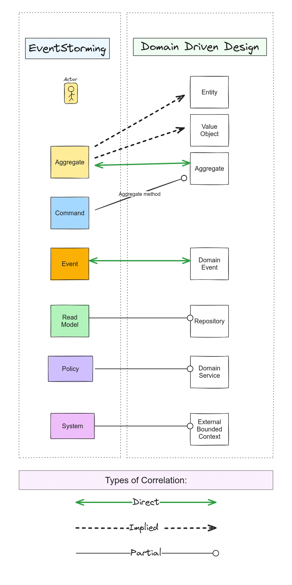
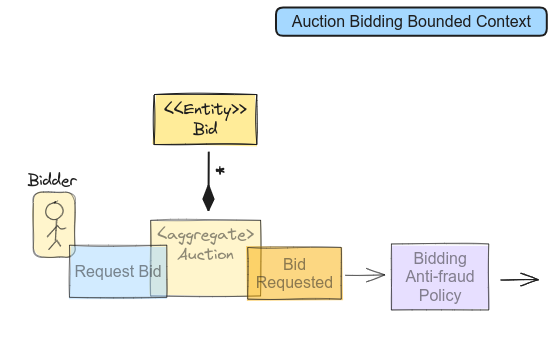

In the realm of software development, understanding and modeling complex business domains remains a persistent challenge. Traditionally, Domain-Driven Design (DDD) practitioners often begin by identifying domain objects, focusing primarily on nouns and structures. However, this approach can lead to premature decisions about system architecture before fully grasping the essence of business processes. EventStorming is an innovative modeling technique developed by Alberto Brandolini, which shifts the focus from static structures to dynamic processes.

To know more how EventStorming can be used for System Design, see my previous article: [EventStorming: navigating complex domains in Domain-Driven Design (example)](/posts/ddd/ddd-eventstorming-example-for-system-design/).

This article explores the relationship between EventStorming and Domain-Driven Design, examining how this verb-centric approach aligns with and complements DDD principles. We’ll delve into the strengths and limitations of EventStorming as a modeling language within the DDD framework and discuss strategies for integrating it effectively into the design process.

## The Process-Oriented Paradigm of EventStorming

EventStorming represents a paradigm shift in domain modeling. Instead of starting with domain objects (nouns), it begins by identifying significant domain events (verbs). This approach offers several advantages:

1.  **Focus on Outcomes**: By emphasizing what happens in a system rather than what exists, EventStorming naturally aligns with business processes and user stories.
2.  **Collaborative Modeling**: The technique prescribes engaging workshops with various stakeholders, fostering a shared understanding of the domain.
3.  **Narrative Flow**: EventStorming creates a storytelling approach to domain modeling, making complex domains more accessible to all stakeholders.

## EventStorming and DDD: Concept Mapping

To evaluate EventStorming’s fitness for Domain-Driven Design, we need to examine how its modeling concepts align with core DDD tactical patterns. Here’s a breakdown of the mapping:

_Mapping between Domain-Driven Design Tactical Design patterns and EvenStorming concepts._

## Direct Correspondences

1.  Domain Events: Represented by orange sticky notes in EventStorming, these align perfectly with DDD’s concept of Domain Events.
2.  Aggregates: Yellow sticky notes in EventStorming often correspond to DDD Aggregates, though with less structural detail.

## Implied Concepts

1.  **Entities**: While not directly represented, Entities are often implied in event descriptions or commands.
2.  **Value Objects**: These may be part of event or command details but are not explicitly modeled.
3.  **Domain Services**: Often implied in complex policies or interactions between multiple aggregates.

## Concepts Not Directly Represented

1.  **Repositories**: Implied in the handling of events and execution of commands, but not explicitly modeled.
2.  **Factories**: Sometimes implied in creation-related commands, but not directly represented.

## Unique EvenstStorming Concepts

1.  **Command**: ften translate to method calls on Aggregates or parameters for Domain Services in DDD.
2.  **Policies:** may translate to Domain Services, Specifications, or business rules within Aggregates in DDD.
3.  **External Systems:** may indicate the need for Anti-Corruption Layers (Bounded Context Mapping) or other specific integration patterns in DDD.
4.  **Read Model: m**ay translate to Repository, which provide methods that allow a client to request objects matching some criteria or data derived from the objects.

## Strengths of EventStorming in DDD Context

1.  **Domain Exploration**: EventStorming excels at uncovering the dynamic aspects of a domain, complementing DDD’s focus on knowledge crunching.
2.  **Ubiquitous Language**: The collaborative nature of EventStorming workshops contributes to developing a shared language among stakeholders.
3.  **Bounded Context Identification**: The event flow often naturally reveals boundaries in the domain, aiding in the identification of Bounded Contexts.
4.  **Alignment with Event-Driven Architectures**: EventStorming naturally aligns with architectural styles that DDD often gravitates towards, such as Event-Driven Architecture, CQRS, and Event Sourcing.

## Limitations and Mitigation Strategies

While EventStorming offers numerous benefits, it also has some limitations in the context of comprehensive DDD modeling:

1.  **Lack of Structural Detail**: EventStorming doesn’t provide much detail about the internal structure of Aggregates, Entities, and Value Objects.  
    **Mitigation**: Supplement EventStorming with UML diagrams or additional sticky note types for structural information when needed.
2.  **Implicit Representation of Some DDD Concepts**: Repositories, Factories, and some Domain Services are only implied in EventStorming.  
    **Mitigation**: Use complementary modeling techniques to capture these concepts explicitly when they are crucial to the domain model.
3.  **High Level of Abstraction**: While beneficial for communication, this can be a limitation for detailed design.  
    **Mitigation**: Recognize that EventStorming is a starting point, and be prepared to dive deeper into specific areas using other techniques.

## Integrating EventStorming into the DDD Design Process

To leverage EventStorming effectively in a DDD context:

1.  **Start with Big Picture EventStorming**: Use this for initial domain exploration and Bounded Context identification.
2.  **Progress to Process Level EventStorming**: Dive deeper into specific processes within identified Bounded Contexts.
3.  **Transition to Design Level EventStorming**: Begin mapping out system design, identifying Aggregates and key Domain Events.
4.  **Supplement with Additional Modeling**: Use UML diagrams or custom notation to capture structural details of Aggregates, Entities, and Value Objects.
5.  **Iterate and Refine**: Continuously refine the model, moving between EventStorming and other modeling techniques as needed.
6.  **Align with Implementation**: Ensure the model aligns with the chosen implementation architecture and patterns.

_dea of how Evenstorming dictionary can be tailored when needed. Here: adding Entity relationship in UML style. Separate UML diagrams would be advisable for clarity._

## Final Thoughts

One notable limitation of EventStorming is its inability to fully capture the structural aspects of domain models, particularly Aggregates (Entities and Value Objects). This shortcoming often necessitates supplementing EventStorming outputs with UML diagrams or other structural modeling techniques. Such a need for additional tools raises questions about EventStorming’s completeness as a design methodology and its alignment with DDD principles.

> In my view, EventStorming adds value to the model description by offering a “storytelling” approach, which aligns closely with how people naturally describe the behavioral aspects of business requirements.

Domain model that is built around nouns reveal essential model elements. Aggregate diagrams, with captured relationships between Entities and Value Objects is vital for the implementation. However, it doen’t really tell the story what the system is supposed to do. The reason for implementation are the use scenarios. They are the starting point and also the criteria of software acceptance. Scenarios help the stakeholders understand the domain and system behaviors, as well as the system intent, in a relatively non-technical way. For this reason, I think the EventStorming outputs can serve as the backbone documentation of the model. This should be complimented by UML diagrams when needed, to add all the necessary details to support the implementation.

Furthermore, the true power of EventStorming emerges when considered in the context of software implementation tools and architectural patterns. DDD emphasizes the importance of aligning domain models with implementation technologies. Certain architectural patterns, such as Event-Driven Architecture, Reactive Messaging with Actor Model, Command Query Responsibility Segregation (CQRS), and Event Sourcing, show strong synergy with DDD principles. In these contexts, EventStorming’s System Design Level shines as a modeling language, effectively capturing and expressing core system concepts. I will dedicate a separate article to cover this topic.

## Summary

By understanding both the strengths and limitations of EventStorming, development teams can use it as a solid foundation for implementing DDD-based solutions that accurately reflect discovered domain knowledge. The key lies in knowing when and how to complement EventStorming with other techniques to create a comprehensive domain model that drives effective software design and implementation.

Key takeaways:

- **Paradigm Shift**: EventStorming offers a dynamic, process-oriented approach to domain modeling, complementing DDD’s traditional focus on static structures.
- **Concept Alignment**: While directly mapping to some DDD concepts (e.g., Domain Events, Aggregates), EventStorming implies rather than explicitly models others (e.g., Entities, Value Objects).
- **Strengths**: Excels in collaborative domain exploration, facilitates Ubiquitous Language development, and aligns well with event-driven architectures.
- **Limitations**: Lacks detailed structural representation, requiring supplementation with other modeling techniques for comprehensive DDD implementation.
- **Strategic Integration**: Most effective when used as part of a broader modeling strategy, starting with Big Picture EventStorming and progressing through more detailed levels, supplemented by other DDD modeling techniques as needed.
