Domain-Driven Design (DDD) is a software design approach that has gained significant traction in recent years. However, it takes time to fully absorb the DDD as it introduces a couple of new concepts, such as Bonded Context, Ubiquitous Language and others.

This article aims to explain the DDD Strategic Design concepts of DDD with an example. We will explore the domain of Elixir University, an institution implementing a Student Registration system for its students. We will see how the DDD Strategic Design framework maps onto the university domain, design process and the organization’s structure.

The knowledge will set the foundation for further exploration of DDD Tactical Design patterns and implementation details. These will be covered in my other articles.

## Table of contents

## Strategic Design — Succinct

Strategic Design in DDD is a set of principles and practices focused on:

1.  Identifying and defining the business Core Domains and Subdomains.
2.  Establishing clear boundaries between different parts of the system (Bounded Contexts).
3.  Developing a shared language (Ubiquitous Language) within each Bounded Context.
4.  Mapping relationships between different Bounded Contexts and Teams (Context Mapping).
5.  Aligning the software architecture with the business strategy and domain structure.

What I find unique about Domain-Driven Design is that it is not only a set of concepts to organize our knowledge about the domain. It actually goes a step further: it investigates the **human and organizational factors** that contribute to successful software design.

In Domain-Driven Design, the Team plays a crucial role in the successful implementation of the approach. The DDD emphasizes the collaboration between Domain Experts and Software Developers, recognizing that neither can fully comprehend the complexities of the domain alone.

However, it is the Organization that determines the strategic importance of various Subdomains and prioritizes a selected Core Domain for further investment. The Core Domain is the essence of your business and what distinguishes you from other competitors.

The Team is responsible for developing a shared understanding of the Core Domain through the creation of the Ubiquitous Language, which serves as the common language for communication and modeling. The team's familiarity with the domain and their collective expertise are essential in identifying and defining the Bounded Context which represents the logical boundaries within the Core Domain.

Various teams working within different areas of the \`Core Domain\` need to effectively communicate and collaborate through establishing Context Mappings. The context mappings facilitate the integration and interaction between different Bounded Contexts.

Ultimately, the success of the DDD project hinges on the Team’s commitment to continuously refining and evolving the domain model, ensuring that the software accurately reflects the ever-changing needs of the business.

## We are in Space — the Problem Space

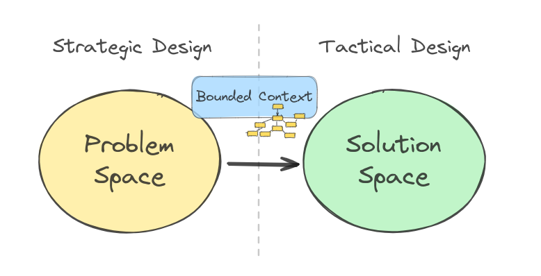
_DDD: Problem Space and Solution Space_

DDD **Strategic Design** patterns belong to the **Problem Space**. In this space, we focus on performing high-level analysis of the domain and its constraints, staying away from technical details. It's not about writing a code or thinking of any specific tech stack, or architecture.

DDD **Tactical Design** patterns are used to gradually transition towards the **Solution space**. We will also be getting closer to the code of the software system. This transition is driven by a sequence of **model transformations** that is covered in my other article.

**Bounded Context** is the main vehicle between the spaces. For now, all you need to know is that Bounded Context is just a model. This model is created as a part of the problem space, and further developed into a software system fitting into the solution space.

## Example Domain: Elixir University

Every academic year students run through the university course offer — didactic, language, physical education etc. Course catalog is made available to the students days before the actual enrollment starts. This gives the students time to prepare their personal enrollment plan. Once the enrollment officially starts, everyone runs to sign up for selected classes before all the others do.

The university is developing a system to support that. A designated university staff task force organizes the student enrollment — it is the Course Enrollment Team.

## Subdomains

A Subdomain represents a specific area of knowledge and functionality within the larger system. It has the following characteristics:

- clear business goal: breaks down the legacy domain model that is too large to work with, into logical parts that have a clear business objective,
- clear area of expertise: can indicate a specific team of domain experts / organizational department that owns the subdomain,
- strategic importance: contributes to the business bringing different strategic value.

The Elixir University has many teams working in different areas of expertise. We could distinguish the following areas/departments (among others): Payroll subdomain, Course Enrollment subdomain, HR subdomain etc.

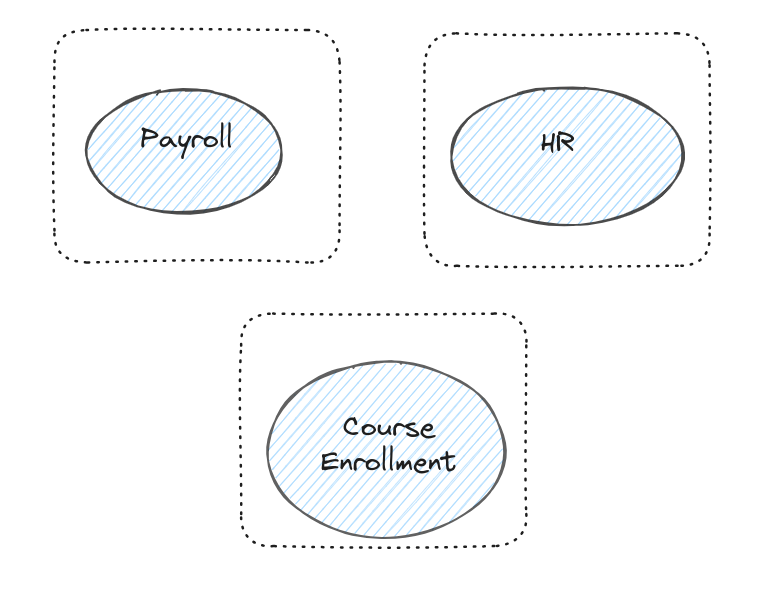
_University Departments_

### **Generic Subdomain**

The university does not have to develop separate software for each of such subdomains. For example, Payroll management is not anything particularly specific to the university business. It is a rather typical subdomain for any institution dealing with employees. Solutions for such domains can often be purchased “off the shelf” — cheaper and with more quality than developed in-house. Such domains in DDD are called Generic Subdomains since they require generic solutions for their problems.

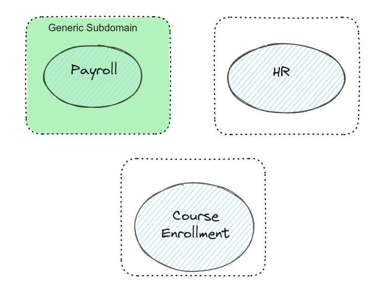
_DDD: Generic Subdomain_

### **Supporting Subdomain**

Not everything can be achieved with generic products, though. Some subdomains may require solutions with different degrees of customization. When a new employee is onboarding at the Elixir University, they receive a laptop, a desk, and access cards to the campus. They also need to pass the basic safety course. Managing different aspects of onboarding may call for an ERP system which is tailored to specific processes implemented at the university. Systems like ERP are incredibly complex. Customization usually takes time and external consultant to implement it. An area which is strategic for the organization where custom development is needed, but development can be outsourced — is called Supporting Subdomain.

A supporting subdomain is important strategically for the business but does not account for what we would call “core activity”. The HR is vital for the university, but in order to have employees to deal with, in the first place the business needs to have a competitive offering that enables the company to hire and then manage their staff.

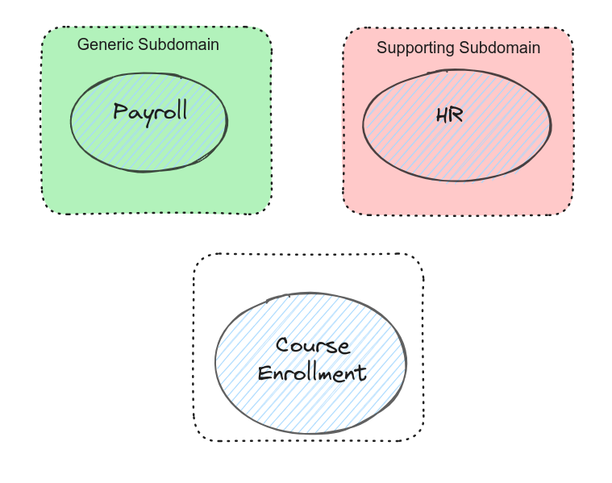
_DDD Supporting Subdomain_

### Core Domain

Typically, a business or system has only one Core Domain. This core domain represents the primary area of strategic importance and competitive advantage for the organization. It's where the organization should focus most of its resources and innovation efforts.

It may be a situation where no “off the shelf” product exists, or it’s hard to customize. Most probably, it is the core product of your business that differentiates you from the competitors. This domain is your business!

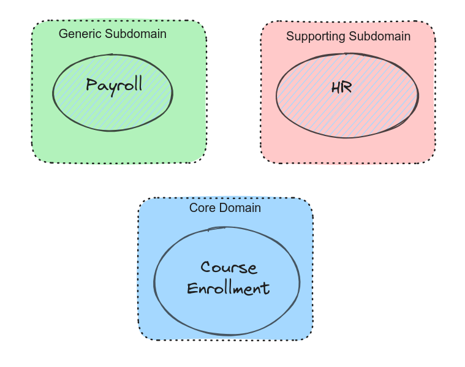
_DDD Core Domain_

One of the university’s core business domains is preparation and execution of the didactic offer. In this perspective, Course Enrollment is a functionality very specific to the university: it has to deal with many Elixir University constraints and ensure concurrent access to the enrollment system for over 30k students. Satisfaction from achieving individual study plans by students is crucial for the university’s reputation. This is one of the factors distinguishing Elixir University from its competitors.

## Core Domain |> Ubiquitous language |> Bounded Context

Domain-Driven Design focuses on the development of the Ubiquitous Language for the Core Domain inside a Bounded Context. It is an iterative process driven by a Team of Domain Experts and Software Developers.

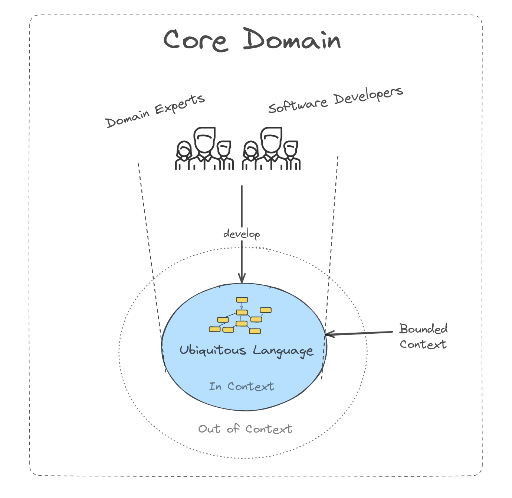
_Team develops a Ubiquitous language that is used to create a domain model_

Let’s take a look at the core concepts:

**Ubiquitous Language**: a shared language that is used by all stakeholders in a project to improve communication and reduce misunderstandings. The Ubiquitous Language is:

- owned and maintained by the Team,
- developed in a collaborative loop
- expressed in the software model
- context dependent
- not “given” — it’s carefully developed by a Team

**Bounded Context** is:

- linguistic and semantic boundary for the Ubiquitous Language
- conceptual boundary around a specific model of Core Domain

**Team** of Software Developers and Domain Experts:

- develops and maintains over time the Ubiquitous Language
- filters out the concepts that do not align with the interest of the strategic initiative (outside the Bounded Context).

### Example of Ubiquitous Language

In our example, the university assigned the funds and gave a green light to implement a solution in support of the Course Enrollment subdomain. The university formed a team of experienced Domain Experts and elixir Software Developers to get their heads spinning around the problem. Here’s a glimpse of a conversation that took place:

> \- Students attend courses during time periods called “terms”. There are usually two terms per academic year. Course Enrollment team prepares a catalog of all the courses made available for Students in the upcoming term. Students can browse this catalog in advance.  
> **_\- How do we know who can enroll for courses?_**  
> \- Well, the Admissions department sends a list of freshly admitted university candidates who will become first year students. We also get a list of Students that dropped out or graduated from the Registrar’s Office. Otherwise, we use a list from the previous term.  
> \- **The actual sign up happens during the Enrollment Campaign- a couple of weeks before the term actually starts, so that the university has time to prepare classrooms the courses, venues and other logistics.**  
> \- Correct! Regarding the course concept — we should definitely add information about a person who leads a course — a Tutor.  
> **\- Could you please elaborate on the tutor more?**  
> \- Sure! A Tutor is a university employee, didactic staff to be precise. So, we have didactic staff and also research staff that only do research. But we also have other types of staff i.e. maintenance, security, admin etc.  
> **\- Gotcha!**  
> \- I just recalled that Tutor also gets some assets from the university to conduct the course: notebook, printing paper, etc.

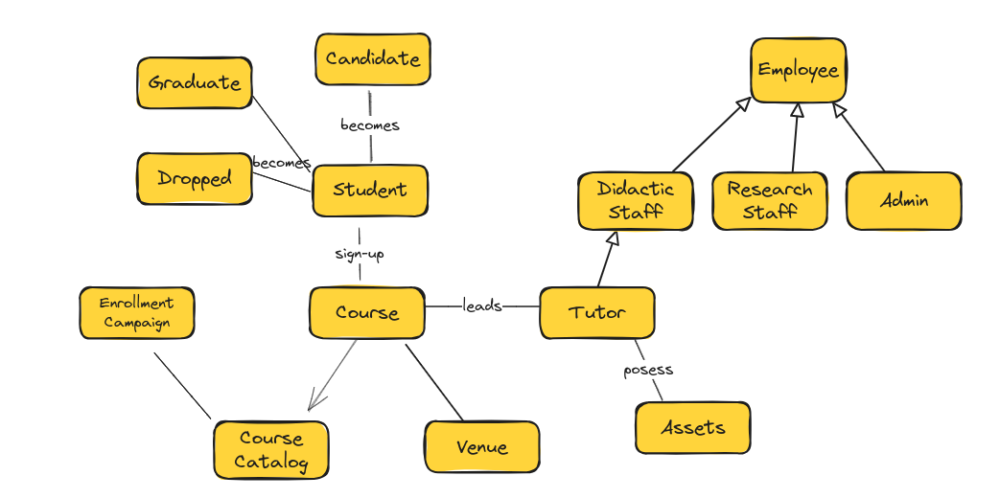
_Domain Model for the Elixir University — Big Ball of Mud_

The conversation is flowing, communication is good, and the team is filling the whiteboard with concepts and relationships between them. It looks great in the beginning as they managed to develop a flowy and stringent Ubiquitous Language. However, after some time, the team realizes that the model got pretty big and many concepts are highly interconnected. They started having doubts whether all the information was indeed relevant for what they want to achieve. At the same time, they don’t feel comfortable about removing anything, as — they think — it might harm the precision of the domain knowledge they gathered by now with so much effort. They seem stuck. They decided to go for lunch.

For the Team it is quite difficult at this moment to reason about any rational segmenting these concepts into functional groups and follow the model single responsibility principle. Boundaries are not obvious. What the team achieved so far bears all the characteristics of what is called in domain design: a “Big Ball of Mud”.

### Taming Model with Bounded Context

When boundaries are not clear, the exploration of the problem space usually leads to a big monolithic model — a “Big Ball of Mud”. Such a domain mega-model tries to cover every aspect of it. It is not necessarily the intent of the designers to grow such a monolith. It’s rather the effect of the domain analysis process: you start with one concept and naturally drill down through all the other concepts it relates to.

To not get off the rails, the Team should be asking themselves constantly one question — “What is the core?”. The Course Enrollment team has been pretty good so far with the development of Ubiquitous Language, but they ended up with some concepts that do not contribute directly to the core domain. When the team gets back to their whiteboard, they start focusing on the concepts needed for the Course Enrollment only. Here is the result of their work:

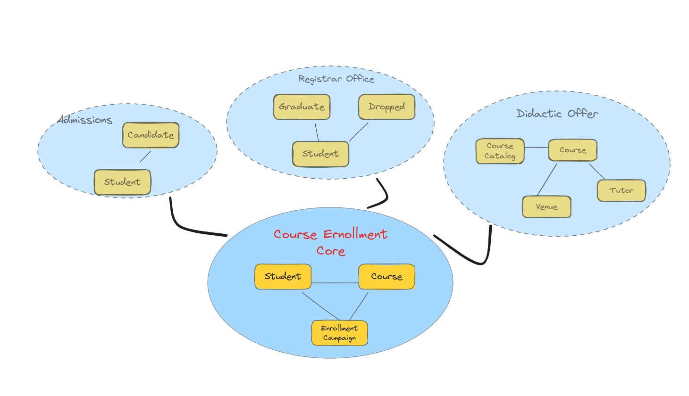
_University Core Domain — Selection of Contexts_

The team decided the decision of who is currently a Student lays out of scope of Course Enrollment. The information management about Candidates, Graduates etc. stays belong in Admissions and the Registrar Office contexts. They notice that Course Catalog creation process is also independent and is driven by another department at the university. The catalog includes information about the courses, tutors, venues etc. This part of the model is shared at some point with the Enrollment Course team but is not managed by it. The information about employee types was found completely irrelevant, so it was removed. The answer to “what is core?” helps the team to realize that the crucial in the enrollment context is the relationship between Student and Course, driven by specific business rules within the duration of the Enrollment Campaign.

## Subdomains vs Bounded Context

In Domain-Driven Design, subdomains and bounded contexts are related but distinct concepts. The following table can help you navigate the differences:

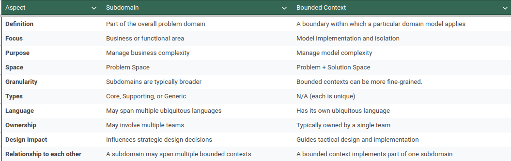
_Subdomains vs Bounded Contexts_

A Bounded Context brings together and isolates concepts that serve a unique business goal. In the ideal DDD world we only work with Bounded Contexts and interactions between them (in a form of Context Mappings). However, when dealing with Legacy Systems, we cannot be assured that their domain models are built with isolation and modularization in mind. Subdomains are used to group and partition the legacy domain models into organizational units. The objective is to achieve a similar functional structure of the Bounded Context when pure DDD is applied. Most of the time, a single Bounded Context would correspond to a single Subdomain.

If we developed a system from scratch using solely a DDD approach, we would have only Bounded Contexts in our view (i.e. HR Bounded Context, Payroll Bounded Context etc.). A Subdomain is a conceptual bridge between existing variety of domain models from legacy system and new Bounded Contexts developed already with DDD.

## Context Mapping

In Domain-Driven Design, **Context Mapping** helps teams understand how different parts of the system relate to and communicate with each other. It also clarifies the boundaries and interactions between different domains or subdomains.

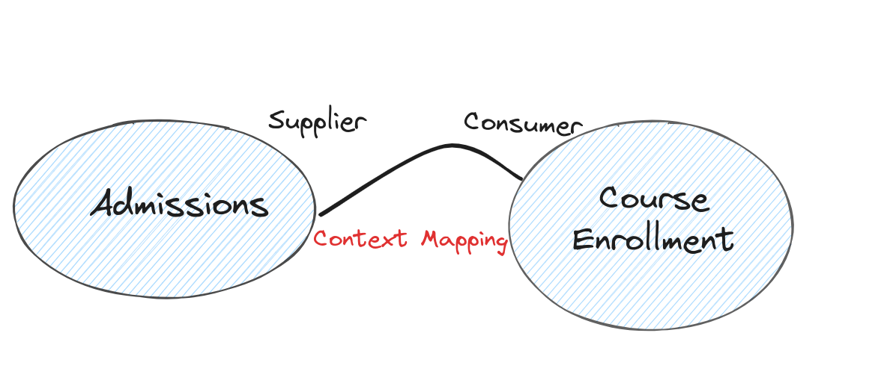
_Mapping between Bounded Context establishes cooperation type between the Teams_

DDD makes team collaboration a first-class citizen. Teams need to interact with each other to share vital information that helps them achieve their business goals. In Elixir University, the information about a Candidate joining the college is passed from the Admission Team to the Course Enrollment Team, so the new student can sign up for classes. The notion of Candidate in admissions has to be translated to the notion of Student in course enrollment. Both teams cooperate to make this information sharing smooth and make some agreements (like Admission model that includes Candidate should not change in the future without a notice as it will impact enrollment operations etc.).

### Types of Context Mapping

There are a couple of integrations approaches between the Bounded Contexts. I will not cover them here in much detail to not mud the waters in this introductory article. Remember that Context Mappings is about types of collaboration between the teams related to the data flow:

- **Partnership**: two teams integrate their software systems closely, treating them as one combined system and sharing the model code across team boundaries. This mapping style is suitable when the teams have a trustful relationship and a substantial overlap in their domain models.
- **Shared Kernel**: involves multiple teams sharing a subset of the domain model, which is treated as a shared kernel, while each team maintains its own context and model for the rest of their respective domains.
- **Customer-Supplier**: one team (the supplier) develops a software system that is consumed by another team (the customer), with a clear upstream-downstream relationship between the two teams.
- **Conformist**: one team (the conformist) adheres to a model defined by another team, essentially treating the other team’s model as the central, canonical model.
- **Anticorruption Layer**: involves creating a translation layer between two different models, allowing them to communicate without tightly coupling or requiring changes to their respective models.
- **Open Host Service**: one team (the host) provides a service that can be extended by other teams through plugins or adapters, enabling a centralized system with extensibility points.
- **Published Language**: involves one team (the publisher) defining and publishing a language or protocol that other teams use to integrate with the publisher’s system, without sharing the internal model.
- **Separate Ways:** teams work on completely separate systems with no integration or shared model, essentially ignoring the existence of other systems and teams.

### Domain Events

Implementation of the Context Mapping requires the Bounded Context to communicate. It’s quite a technical question, but DDD Tactical Design brings a concept of a **Domain Event**. Contexts can share information with each other about what has happened by generating and sending asynchronously domain events. Other Bounded Contexts can subscribe to these events and react accordingly.

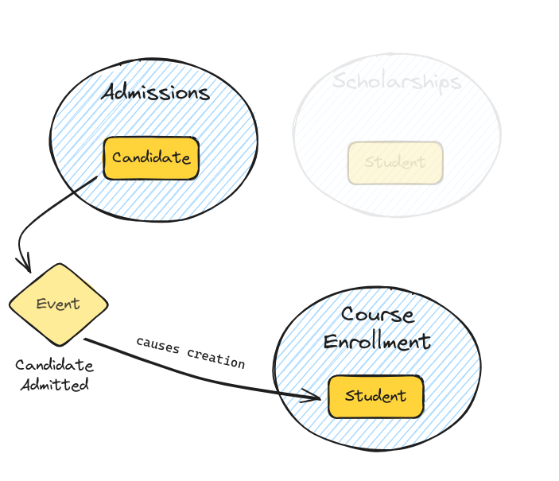
_Domain Event_

In our example, the Admission Context could generate CandidateAdmitted event. The Course Enrollment Context can listen to such events and in response create a new Student entity, so that a new student can take part in the enrollment campaign for the upcoming term at the university.

It is also viable for the Domain Events to be produced and consumed within the same Bounded Context.

## Summary

In this article, we learned:

- **Teams** composed of Domain Experts and Software Developers are main drivers of the design process.
- Core business functionality that is prioritized by an organization for investment is called **Core Domain**.
- A dedicated Team is responsible for developing a shared understanding of the Core Domain through the creation of the **Ubiquitous Language** for communication and modeling.
- The crucial role of **Bounded Contexts** is managing domain complexity by defining boundaries of a model that will become a source of the software solution implementation.
- **Subdomains**: help conceptualize large systems and legacy domain models by breaking them down into logical parts with clear business goals, areas of expertise, and strategic importance.
- Successful DDD implementation hinges on **continuous refinement of the domain model** by the Team to ensure the software reflects the ever-changing business needs.
