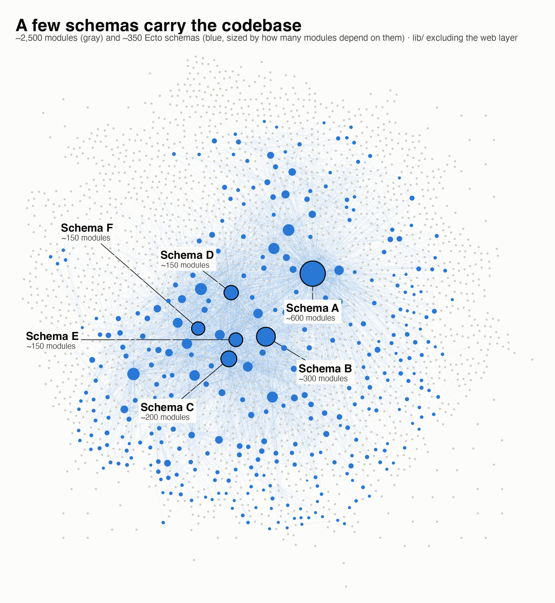
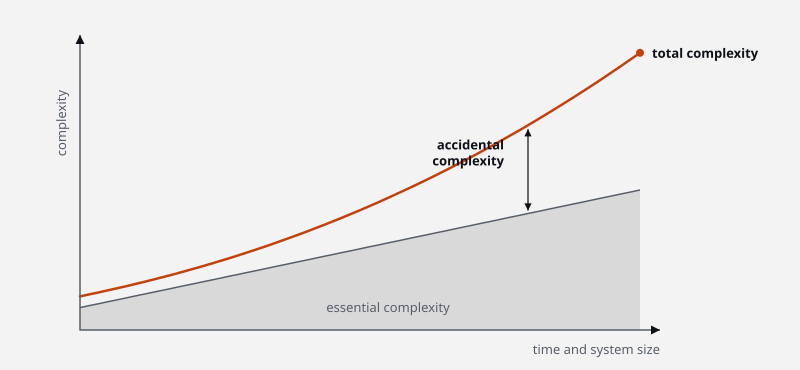
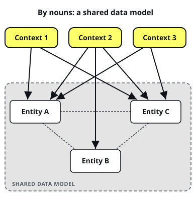

Large codebases rarely get simpler. Complexity creeps in with every feature.

With the advent of AI, more and more code is automatically generated. Keeping that complexity in check matters more than ever. We still have to **review the code, understand it and answer for it**.

Back in 2019, in his talk [*The Big Ball of Nouns*](https://www.youtube.com/watch?v=hgDCg3QdZgU), [Maciej Kaszubowski](https://mkaszubowski.com/) introduced the Elixir community to **Modular Design**, a lean approach to structuring systems for maintainability and testability. Clear module boundaries make that possible.

In this article, I look at where that complexity comes from, why splitting a system by nouns makes it worse, and how splitting it by behaviour helps. A worked example from my side project runs through the whole article.

## What 10 years of growth looks like

A project I've worked on is a typical Phoenix + Postgres app. It has been commercially successful for about 10 years, and the codebase shows it:

- about 2,500 modules
- about 30,000 functions
- nearly 300 tables
- over 100 references to the most connected schema
- **several tables with over 100 fields**

Numbers like these are hard to picture, so here are all the connections between the app's modules and schemas:



This is a monolithic domain model with very high coupling: almost everything is connected to everything else. Nobody can hold a system like this in their head.

> [!info] How much fits in our head?
> Miller's Law [^miller] puts the limit of our short-term memory at roughly **7 ± 2 items**, and later research suggests **it's closer to 4** [^cowan].

Fortunately, AI tools don't share that limit in the same way. They're good at navigating a codebase like this, and they help us:

- trace coupling across modules,
- spot edge cases we'd miss,
- implement changes faster.

However, AI models don't take **accountability** for the code they write. We do. A **human still signs off on a feature, and a human still reviews it**. Both need to understand what changed and what it might break. That's only possible if the system stays understandable for people, not just for machines.

So can we make a system like this less complex?

## Essential vs accidental complexity

> Complexity is like a waterbed. Push it down in one place, and it bulges up somewhere else.

Larry Wall

Fred Brooks [^brooks] split complexity into two kinds:

- **essential complexity** comes from the problem itself. A system that handles payments, permissions and scheduling is complex because those problems are complex.
- **accidental complexity** comes from how we build the solution: our tools, our structure and our design decisions.

No code organisation or architectural pattern can remove essential complexity. Big systems are complex, and there's no magic trick here.

Accidental complexity is a different story. Coupling through a shared data model, for example, isn't required by the problem. We introduced it, so we can also reduce it.

<figure>



<figcaption>Essential complexity grows with the system. Accidental complexity is the gap above it, and that gap is the part the design decides.</figcaption>

</figure>

## Quality of the System Decomposition

Let's accept that we cannot get rid of complexity. **Our goal is different: keep the accidental part of the complexity small.**

How we decompose a system has a big say in that. It largely decides the system's **maintainability**, one of the product quality characteristics in ISO/IEC 25010 [^iso25010].

The ISO standard breaks maintainability into five sub-characteristics, and each one maps to a question we ask in everyday work:

- **modularity**: does a change to one part leave the others alone?
- **reusability**: can we use a part elsewhere without dragging its dependencies along?
- **analysability**: can we tell what a change will affect?
- **modifiability**: can we change it without breaking something else?
- **testability**: can we test it easily, on its own?

So the real question is: **how do we decompose the domain to score well on all five to reduce the accidental complexity?**

## The Big Ball of Nouns

The most common way to model a domain is to decompose it by nouns, a technique taught in object-oriented analysis since the early 1980s [^abbott]:

1. pick out the nouns in the requirements and make them domain objects (in Phoenix: schemas),
2. define the relationships between them (associations, foreign keys),
3. turn the verbs into functions on those objects, grouped by the noun they touch.

Notice the order: the data model is settled before we've looked at what the system actually does. Behaviour comes last, so it has to fit whatever shape the data already has.

It's no surprise that we start here. We're used to thinking in nouns: object-oriented programming, database tables, REST resources and CRUD all begin with them.

In a Phoenix app, this gives us a set of contexts, usually one per noun, that all reach into the same schemas:

- **directly**: CRUD and other schema-specific operations,
- **indirectly**: preloaded associations, joins and so on.

<figure>



<figcaption>Every context uses several entities, and the entities are linked to each other, so a change to one entity can reach any context.</figcaption>

</figure>

The result is one big data model that every context depends on. Maciej calls it a **Big Ball of Nouns**, a close cousin of the *Big Ball of Mud*, Brian Foote and Joseph Yoder's name for a system without clear structure [^mud]. The coupling isn't only in the module interfaces. It's also in the data the modules share. This design leads to:

- **high coupling**: contexts depend on each other's schemas, not just on each other's functions,
- **weak boundaries**: nothing stops one context from reading or changing another context's data,
- **big modules**: each noun's context collects every business scenario that touches that noun,
- **scattered business logic**: the rules for a single scenario end up spread across several contexts,
- **bloated schemas**: the same noun means different things in different scenarios (an order at checkout isn't the order in shipping), but it gets one schema, which grows a field for every scenario. That's how a table ends up with over 100 fields.

The cost shows up when a new feature arrives. Changing a domain object, for example adding a field to a schema, means we have to:

- find every module that uses the schema, directly or through associations,
- check that existing functions, queries and reports still behave correctly,
- update tests at every level, from unit tests to integration tests.

Most of this work has nothing to do with the feature we were asked to build. In that project, a change to the most connected schema can mean checking over 100 places. That's accidental complexity at work.

## Modular Design: an idea from 1972

Modular Design goes back to David Parnas's 1972 paper "On the Criteria To Be Used in Decomposing Systems into Modules" [^modular-design].

Parnas argued that the way you split a system decides how easy it is to understand, change and maintain. His answer still holds: split the system around the decisions that are difficult or likely to change, and let each module hide one of them behind its interface. This idea is known as **information hiding**.

<figure>


<figcaption>Information hiding: other modules only see the interface. The secret behind it can change without any caller noticing.</figcaption>

</figure>

The secret can be a data structure, an algorithm or anything else likely to change. Hiding it gives us three things:

- **Encapsulation**: other modules only see the interface, never the secret.
- **Contained change**: the secret can change without the change spreading.
- **Extension over modification**: a new feature becomes a new module that uses existing interfaces, rather than edits to the modules we already have. That's the open-closed principle from SOLID: open for extension, closed for modification.

That's the opposite of the big ball of nouns, where every context reaches into one shared data model and no decision is hidden anywhere.

There's one more point worth making. Domain-Driven Design's bounded contexts and microservices look like very different ideas, but they answer the same question: where do the boundaries go? Neither of them requires a distributed system. We can get strong boundaries in a monolith with a single PostgreSQL instance, as long as each module owns its data and its decisions.

## Decomposing by behaviour

Modular Design puts behaviour first. Instead of asking "what are the things in this domain?", we ask "what does the system need to do?". The data model exists to support that behaviour, not the other way round.

This also fixes the bloated schemas from the big ball of nouns. The same noun can mean different things in different modules, and now each module gets its own version of it. To billing, a *customer* is someone with a payment method. To support, the same customer is someone with a ticket history. In Domain-Driven Design terms, each lives in its own bounded context.

Done well, decomposition by behaviour gives us:

- **small modules** that do one job and fit in our heads (analysability),
- **stable interfaces** that rarely need to change (modifiability),
- **low coupling**, because modules share interfaces, not data (modularity, testability),
- **replaceable modules** that we can rewrite or remove without touching the rest (modularity, reusability).

<figure>


<figcaption>Left: contexts use entities from one shared data model, and the entities are linked to each other, so changing one entity can break every context that uses it. Right: each module keeps its data to itself behind an interface, so it can change without affecting the others.</figcaption>

</figure>

Let's see both approaches on one concrete example.

## Example, part 1: events by nouns

To make this concrete, I'll follow the structure of Maciej's example from the talk but apply it to my side project, `haps.today`. It's a platform for curating neighbourhood events and sending them to subscribers on WhatsApp.

We start with one requirement:

- An author publishes an event to the platform.

Thinking in nouns, we get a single `Event` entity with its data and the rules that guard it. On the left is the schema, on the right the interface other modules depend on:

<div class="code-pair">

```elixir file="Schema"
Event
  title: string
  description: string
  start: datetime
  duration_minutes: integer
  cancelled: boolean

  belongs_to: Author
```

```elixir file="Interface"
Events
  fetch_by_id(id)
  publish(event)
  cancel(event)
  search(query)
  find_by_author_id(author_id)
  find_by_date(date)
```

</div>

This is pretty easy. One schema and one module around a single noun.

### New feature: Slugs

Now we want readable URLs, for example `/events/2026/10/26/elixir-meetup`. Following the traditional Phoenix approach, we extend the schema and add a context function that covers the new behaviour. The schema and interface become:

<div class="code-pair">

```elixir file="Schema"
Event
  title: string
  description: string
  start: datetime
  duration_minutes: integer
  cancelled: boolean
  slug: string # [!code ++]

  belongs_to: Author
```

```elixir file="Interface"
Events
  fetch_by_id(id)
  publish(event) # [!code highlight]
  cancel(event)
  search(query)
  find_by_author_id(author_id)
  find_by_date(date)
  find_by_slug(slug) # [!code ++]
```

</div>

A small change: one new field (`slug`) and one new function (`find_by_slug(slug)`).

But `publish(event)` had to change too! It now generates the slug every time an event is published.

### New feature: Review events

Next requirement: a reviewer has to verify each event before it goes public. The workflow becomes `Submit → Review → Publish`, and the schema and interface change like this:

<div class="code-pair">

```elixir file="Schema"
Event
  title: string
  description: string
  start: datetime
  duration_minutes: integer
  cancelled: boolean
  slug: string
  status: [:submitted, :rejected, :published] # [!code ++]
  rejection_reason: string # [!code ++]

  belongs_to: Author
  belongs_to: Reviewer # [!code ++]
```

```elixir file="Interface"
Events
  fetch_by_id(id)
  publish(event) # [!code highlight]
  cancel(event)
  search(query, status) # [!code highlight]
  find_by_author_id(author_id, status) # [!code highlight]
  find_by_date(date, status) # [!code highlight]
  find_by_slug(slug, status) # [!code highlight]
  submit(event) # [!code ++]
  reject(event, reason) # [!code ++]
```

</div>

Let's go through what has changed:

- **New field `status`**: the event now has a lifecycle (`:submitted`, `:rejected`, `:published`) instead of being published straight away.
- **New field `rejection_reason`**: the author needs to know why the event was rejected.
- **New association `Reviewer`**: someone other than the author now has to approve the event, so `Event` holds a second relationship.
- **New functions `submit(event)` and `reject(event, reason)`**: the author no longer publishes. They submit, and the reviewer either rejects or publishes.
- **Modified `publish(event)`**: it used to be the author creating an event (and, since the slugs feature, generating the slug). Now it's a reviewer action that only works on a `:submitted` event. Its meaning changed, so every caller has to be checked.
- **Modified `search`, `find_by_author_id`, `find_by_date` and `find_by_slug`**: each one now takes a `status` argument. A regular visitor should only see published events, while authors and reviewers need to see submitted or rejected ones too. That changes every function signature, so every caller has to change as well.
- **Unchanged but still checked: `cancel(event)` and `fetch_by_id(id)`**: their code didn't change, but we still had to work out how `cancelled` relates to the new `status` and whether `fetch_by_id` should return an event nobody has published yet.

Overall, one feature cost us:

- **Schema**: 2 new fields and 1 new association.
- **Interface**: 2 new functions, and 5 of the 7 existing ones changed.
- **Re-checks**: the other 2 functions didn't change, but we still had to re-check them.
- **Callers**: every place the context is called had to be checked to make sure nothing broke.

## Beyond one context

The example is small, but it shows a trend. Every new feature lands on the same entity, and each one costs more than the last:

- **More fields** on the same schema.
- **More arguments** on the same functions.
- **More to re-check**: every existing function, the tests and changesets behind it, and every caller of the interface.
- **More to keep in your head**: each feature adds to the cognitive load of the next one.

And the example is still kind to us: one schema and one context. A real app has many of both, and the schemas aren't private to any context. Any context can query any table, and Ecto associations link the schemas to each other. In `haps.today`, for example:

- **`Notifications`** joins its subscriptions with events to build the WhatsApp digest.
- **`Reports`** counts events per author per month. It loads authors and preloads their events through `has_many :events`, so it depends on `Event` without ever naming it.

Each of those queries depends on the shape of the `Event` schema, not on the `Events` interface.

<figure>


<figcaption>No context owns a schema. The schemas form one shared data model linked by relations, and any context can use any of them: <code>Notifications</code>, <code>Events</code> and <code>Reports</code> all depend on <code>Event</code>.</figcaption>

</figure>

When the review feature adds `status`, every one of those queries has to learn to skip unpublished events. Miss one, and the WhatsApp digest sends out an event that a reviewer has rejected.

The hard part is finding them. Nothing in the `Events` interface tells you where those queries are, so you have to search the codebase.

At scale, it gets worse. In the project I've worked on, a feature that touches one of the 100-field schemas means retesting most of the system to be sure nothing broke.

This is the core problem with a monolithic, noun-based data model, which is how most Phoenix apps grow. Maciej sees the same pattern in most projects:

- a few entities organised around nouns,
- behaviour spread across all of them,
- other contexts reading the same tables directly, around the interface,
- most actions represented as updates to the same rows: a new `status`, another flag,
- high coupling.

## Modular Design Recipe

The goal of behaviour-first decomposition is to **isolate important decisions**.

Start with a list of the decisions that matter in your domain, such as business rules, workflows and integrations with other systems. Then create a module for each decision: the behaviour becomes the module, and the decision it makes is the secret the module hides. To design each module, Maciej asks four questions, in this order:

1. What is the desired outcome?
2. What data do I need to do this?
3. How can I get this data?
4. What should be exposed in the interface?

The order matters. We start from the outcome, so the module only holds the data that outcome needs, and the interface comes last, shaped by the behaviour rather than by a schema.

> [!tip] Finding the outcomes with Event Storming
> Event Storming is a good workshop for finding these outcomes, because it focuses on what happens in the domain rather than on data. I describe it in [EventStorming: navigating complex domains in Domain-Driven Design (example)](/posts/ddd/ddd-eventstorming-example-for-system-design/).

## Example, part 2: events by behaviour

Back to `haps.today`. Let's recap the functionality we want to have:

- An author submits an event.
- A reviewer accepts or rejects it for publishing.
- Visitors open a published event through a readable URL.

If we map each behaviour to a module, we get:

- **Publishing**: visitors can see the events that reviewers have accepted. It decides what's visible.
- **Submissions**: reviewers accept or reject submitted events. It decides what's good enough.
- **Slugs**: a dictionary of events and their slugs. It decides what URLs look like.

### `Publishing`

**Decision**: serve published events to the public.

We start with the core feature: making an event public. This module does just one thing: it serves published events, no matter how they got there.

- It doesn't care whether an event was reviewed, or what it looked like as a submission.
- Everything in it is published by definition, so there's no workflow status, and queries don't need to filter by it.
- Cancelling is a publishing concern, so `cancelled` lives here too.

1. **Outcome**: visitors can find and read published events, and see when one is cancelled.
2. **Data**: title, description, start, duration, author and whether it's cancelled.
3. **Source**: Submissions hands over an accepted event. Publishing doesn't know or care how it was approved.
4. **Interface**: publish an event, cancel it, fetch it by id and search.

<div class="code-pair">

```elixir file="Schema"
Event
  title: string
  description: string
  start: datetime
  duration_minutes: integer
  author_id: uuid
  cancelled: boolean
```

```elixir file="Interface"
Publishing
  publish(event_params)
  cancel(event_id)
  fetch_by_id(id)
  search(query)
```

</div>

### `Slugs`

**Decision**: map a readable slug to an event id.

In the noun-based version, slugs forced us to change `publish(event)`. Here they are a module of their own that maps slugs to ids and back.

1. **Outcome**: a readable URL resolves to an event, and an event has a readable URL.
2. **Data**: the event id and its slug.
3. **Source**: the web layer, right after an event is published. Publishing never calls Slugs.
4. **Interface**: assign a slug to an event and look up an event id by its slug.

<div class="code-pair">

```elixir file="Schema"
Slug
  event_id: uuid
  slug: string
```

```elixir file="Interface"
Slugs
  assign(event_id, slug)
  get_id_by_slug(slug)
```

</div>

<figure>


<figcaption>Opening an event by its URL: the web UI asks Slugs for the id, then asks Publishing for the event. Neither module knows about the other.</figcaption>

</figure>

### `Submissions`

**Decision**: accept or reject events submitted by authors.

Now we model the review part of the app. This module decides whether a submitted event is good enough. A reviewer either accepts it and sends it to Publishing, or rejects it with a reason that tells the author what to fix.

Its `Submission` looks a lot like the `Event` in Publishing, but it means something different: an event waiting for a decision, not a published one.

1. **Outcome**: a reviewer accepts or rejects each submitted event, and the author learns why it was rejected.
2. **Data**: the submitted event, its author, the decision, the rejection reason and the reviewer.
3. **Source**: the author's submission form. On accept, the event goes on to Publishing.
4. **Interface**: submit an event, list submissions, accept one and reject one with a reason.

Question 2 catches a gap here: a rejection needs a reason, so `reject` takes one as an argument.

<div class="code-pair">

```elixir file="Schema"
Submission
  title: string
  description: string
  start: datetime
  duration_minutes: integer
  author_id: uuid
  status: [:pending, :accepted, :rejected]
  rejection_reason: string
  reviewer_id: uuid
```

```elixir file="Interface"
Submissions
  submit(event_params)
  list_submissions()
  accept(submission)
  reject(submission, reason)
```

</div>

<figure>


<figcaption>Submitting and reviewing an event. Only an accepted event crosses into Publishing; a rejection, and its reason, stay inside Submissions.</figcaption>

</figure>

Modules may call each other, as Submissions calls Publishing here, but only through the interface, which is the part designed to stay stable.

## Interface is the Core

The interface is the module's whole contract, but only if it's strict. If `publish/1` accepts any params map, callers come to depend on whatever keys happen to work.

**Accept a struct, not loose params.** `Publishing.publish/1` takes a `%Publishing.Event{}`, so a missing field fails at the call site, not deep inside the module:

```elixir
defmodule Publishing.Event do
  @keys [:title, :description, :start, :duration_minutes, :author_id]
  @enforce_keys @keys
  defstruct @keys
end
```

Saša Jurić describes the same split in *Towards Maintainable Elixir: The Core and the Interface* [^juric]. His *interface* is the edge of the system, not a module's public functions: controllers, LiveViews and jobs. It turns raw external input into well-shaped data, a struct or a map with known keys and types. The core only ever works with that. Validation happens once, at the edge, and the core doesn't have to defend itself against string keys and half-filled params.

**If you use Ash, you're at home.** The resource declares the fields and their types, and the action declares which of them it accepts. Ash casts and validates the input before the action runs, and a code interface exposes it as a plain `Publishing.publish/1`:

```elixir
defmodule Publishing.Event do
  use Ash.Resource, domain: Publishing

  attributes do
    uuid_primary_key :id
    attribute :title, :string, allow_nil?: false
    attribute :description, :string, allow_nil?: false
    attribute :start, :utc_datetime, allow_nil?: false
    attribute :duration_minutes, :integer, allow_nil?: false
    attribute :author_id, :uuid, allow_nil?: false
  end

  actions do
    create :publish do
      accept [:title, :description, :start, :duration_minutes, :author_id]
    end
  end
end
```

The struct and the Ash resource describe the same contract. The difference is that Ash also checks the types: `"90"` is cast to `90`, and `"tomorrow"` in `start` is rejected before the action runs.

**A strict interface also splits the testing work**.

Turning raw params into a struct is tested once, at the edge. The module's own tests start from a struct, which tells them exactly what input to build, so they can focus on the module's rules instead of string keys and missing fields.

<figure>


<figcaption>The web layer turns raw params into a <code>%Publishing.Event{}</code>, and that step is tested at the edge. The module's tests start from the struct and call the same interface.</figcaption>

</figure>

## Nouns vs Behaviour, side by side

We've now built the same features twice. Complexity didn't go away in either version. What changed is where it lives.

Decomposing by nouns put it in a shared data model. Every new feature added fields to the same entity and arguments to the same functions, and every change had to be checked across the whole system. Decomposing by behaviour puts it in small, stable interfaces between modules that keep their data to themselves.

<figure>


<figcaption>Left: every function reads and writes the same Event table, and all of them depend on <code>status</code>, so changing it touches all of them. Right: each module keeps its own data, and the web layer reaches it only through its interface. The one arrow between modules is Submissions handing an accepted event to Publishing.</figcaption>

</figure>

Back to the five maintainability questions from the start, plus one more: deletability.

| | Nouns | Modular Design |
|---|---|---|
| *Result* | One big `Events` context with multiple responsibilities | Single-responsibility modules: Publishing, Submissions, Slugs |
| **Modularity**: does a change to one part leave the others alone? | Rarely.<br>Adding `status` changed 5 of 7 functions and every query that joins `Event`. | Usually.<br>The review workflow lives entirely in Submissions, and adding slugs didn't touch Publishing. |
| **Reusability**: can we use a part without dragging its dependencies along? | Hard.<br>Reusing `Event` means taking its author, reviewer, status and slug along. | Easy.<br>Slugs only needs an event id and a slug. |
| **Analysability**: can we tell what a change will affect? | Hard.<br>Callers reach into the schema directly, so finding everything a change affects means searching the codebase. | Easy.<br>The interface lists everything callers can depend on: four functions for Publishing. |
| **Modifiability**: can we change it without breaking something else? | Hard.<br>Every feature changes the same context: `publish` had to change for slugs and again for reviews. | Easy.<br>A new feature is usually a new module, like Slugs. Even the storage behind an interface can change, say from Ecto to ETS, without callers noticing. |
| **Testability**: can we test it on its own? | Hard.<br>Tests depend on the shared schema: testing `search` means creating events in every status, and each new feature adds cases to existing tests. | Easy.<br>Each module is tested through its interface with only its own data: Publishing tests never create a submission or a reviewer. |
| **Deletability**: can we remove a feature we no longer need? | Hard.<br>Dropping reviews means taking `status`, `rejection_reason` and the reviewer back out of `Event`, then fixing every function and query that uses them. | Easy.<br>Dropping reviews means deleting Submissions along with its data, wherever it's stored, and sending the submit form straight to Publishing. Publishing and Slugs don't change. |


## Modular Design Trade-offs

Modular Design is not a magic wand. It costs something:

- **Duplicated data**: Submissions and Publishing both hold the event's title, description and dates. Copies have to be kept in sync, and someone has to decide which one is the source of truth. What happens when the author fixes a typo in an event that's already published? Does the edit go to Submissions, straight to Publishing, or through review again? That's a business decision the shared table used to hide.
- **Communication between modules**: modules call each other's interfaces or exchange events instead of sharing tables. That's more code, and sometimes eventual consistency.
- **Transactions get trickier**: a single business operation can span several modules, and those modules don't have to share the same data layer. One might keep its data in Postgres, another in ETS or behind an external API, so one database transaction can't always cover the whole operation. When a step fails halfway, the modules can disagree, and we have to handle it ourselves with retries, idempotent operations or compensating steps.
- **Cross-cutting reads get harder**: reports and dashboards that used to be a single join now pull data from several modules.
- **Boundaries are hard to get right up front**: a wrong cut is expensive to move later. Event Storming helps, because it keeps the focus on outcomes rather than tables.
- **It goes against the grain**: Phoenix generators and most tutorials start from schemas, so the team has to unlearn the noun-first habit.
- **Performance**: a single join across tables can become several calls across modules. It's usually fine, but worth measuring on hot paths.
- **The UI sometimes has to change**: a screen that showed everything about an event in one place may need to pull from several modules, or be split along the new boundaries.

## Conclusion

Modular Design isn't a framework or a library. It's a mindset: focus on behaviour, not data, and encapsulate important decisions.

The payoff is a system you can understand one module at a time: small enough to fit in your head, and small enough for AI tools to change safely. Since you stay accountable for every change, that matters more than ever.

[^iso25010]: [ISO/IEC 25010:2023 - Systems and software engineering - Systems and software Quality Requirements and Evaluation (SQuaRE) - Product quality model](https://www.iso.org/standard/78176.html)

[^modular-design]: ["On the Criteria To Be Used in Decomposing Systems into Modules" (1972) by David L. Parnas](https://dl.acm.org/doi/10.1145/361598.361623)

[^brooks]: [Brooks, Frederick P. (1987), "No Silver Bullet: Essence and Accidents of Software Engineering", Computer 20(4)](https://doi.org/10.1109/MC.1987.1663532)

[^miller]: [Miller, George A. (1956), "The Magical Number Seven, Plus or Minus Two: Some Limits on Our Capacity for Processing Information", Psychological Review 63(2)](https://doi.org/10.1037/h0043158)

[^cowan]: [Cowan, Nelson (2001), "The magical number 4 in short-term memory: A reconsideration of mental storage capacity", Behavioral and Brain Sciences 24(1)](https://doi.org/10.1017/S0140525X01003922)

[^mud]: [Foote, Brian and Yoder, Joseph (1997), "Big Ball of Mud", Pattern Languages of Programs (PLoP '97)](http://www.laputan.org/mud/)

[^abbott]: [Abbott, Russell J. (1983), "Program design by informal English descriptions", Communications of the ACM 26(11)](https://doi.org/10.1145/182.358441)

[^juric]: [Jurić, Saša (2021), "Towards Maintainable Elixir: The Core and the Interface", Very Big Things](https://medium.com/very-big-things/towards-maintainable-elixir-the-core-and-the-interface-c267f0da43)
